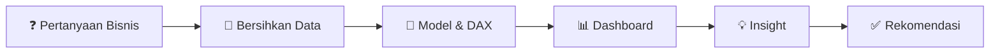

 

---

## 👋 Tentang Saya

Saya seorang **Data Analyst** yang berfokus pada **Business Intelligence**. Saya bekerja dengan satu prinsip: **angka baru berguna kalau bisa mengubah keputusan.**

Karena itu, setiap project saya tidak berhenti di grafik. Saya mencari **pertanyaan bisnisnya**, menemukan **penyebabnya**, lalu menutup dengan **rekomendasi yang bisa ditindaklanjuti**. Saya juga terbiasa memeriksa ulang angka sebelum dipercaya, termasuk menandai ketika sebuah metrik di dashboard ternyata menyesatkan.

- 🎓 **Pendidikan:** Universitas Koperasi Indonesia — Sains Data
- 🧑‍💻 **Program:** Magang dan Studi Independen Bersertifikat (MSIB) Batch 7, **RevoU** — Data Analytics & Gen AI
- 📍 **Lokasi:** Indonesia
- 🔎 **Mencari:** posisi *Data Analyst* / *Business Intelligence Analyst* (magang atau penuh waktu)

---

## 🛠️ Keahlian

| Bidang | Kemampuan |
|---|---|
| 📊 **Visualisasi & BI** | Power BI Desktop, desain dashboard interaktif, KPI, slicer, peta |
| 🧮 **Pemodelan & Kalkulasi** | DAX (measure, margin, YoY), tabel kalender |
| 📑 **Pengolahan Data** | Microsoft Excel, pembersihan data CSV, pemeriksaan kualitas data |
| 💡 **Analisis Bisnis** | Analisis profitabilitas, tren musiman, pengaruh diskon, segmentasi |
| 🤖 **Generative AI** | Pemanfaatan Gen AI untuk mempercepat analisis dan dokumentasi |
| 🗣️ **Komunikasi** | Menyusun insight dan rekomendasi dalam bahasa yang mudah dipahami |

<!-- Tambahkan baris berikut HANYA jika Anda memang menguasainya:
| 🐍 **Bahasa Pemrograman** | Python (pandas, matplotlib), SQL |
-->

---

## 🔄 Cara Saya Bekerja

---

## 🚀 Project Unggulan

### 1️⃣ US Furniture Sales Performance
<table>
<tr>
<td width="46%"></td>
<td>

**Masalah:** Penjualan kategori Furniture di pasar AS besar, tetapi apakah menguntungkan?

**Temuan:**
- Dari penjualan **$742 ribu**, profit hanya **$18,4 ribu** (margin **2%**).
- **Tables** menjual banyak tetapi merugi **−$17,7 ribu**. **Bookcases** juga merugi.
- Profit berbalik negatif saat **diskon mencapai 30% ke atas**.

**Rekomendasi:** batasi diskon, tinjau harga Tables, dan andalkan Chairs serta Furnishings.

🧰 `Power BI` `DAX` `Global Superstore` · 👥 Proyek tim (Team 4 Merauke, RevoU)

[➡️ Lihat repo](https://github.com/ashafamultazam/Data-Analytics-and-Gen-AI-Project)

</td>
</tr>
</table>

### 2️⃣ Global Sales and Profitability Dashboard
<table>
<tr>
<td width="46%"></td>
<td>

**Masalah:** Seberapa besar diskon menggerus keuntungan, dan segmen mana yang paling menguntungkan?

**Temuan:**
- Total penjualan **118,73 juta** dengan margin **14,23%**.
- Margin turun dari **21,86% (tanpa diskon)** menjadi **9,07% (diskon tinggi)**.
- Segmen **Enterprise merugi**, sementara **Government** paling dominan.

**Rekomendasi:** evaluasi kebijakan diskon tinggi dan telusuri penyebab kerugian Enterprise.

🧰 `Power BI` `DAX` `Excel` `Analisis Profitabilitas`

[➡️ Lihat repo](https://github.com/ashafamultazam/Tugas-Business-Intelligence)

</td>
</tr>
</table>

### 3️⃣ Dairy Strategic Performance Dashboard
<table>
<tr>
<td width="46%"></td>
<td>

**Masalah:** Bagaimana tren pendapatan industri susu di India dan di mana risikonya?

**Temuan:**
- Revenue **58,73 juta INR**, turun sekitar **7,5%** dari 2019 ke 2022.
- **4 merek** menguasai hampir **79%** revenue. **Chandigarh dan Delhi** menyumbang ±25%.
- Menemukan bahwa kartu *Total Profit* (−59,59 juta) **menyesatkan** karena membandingkan revenue barang terjual dengan nilai seluruh barang produksi, lalu mengusulkan metrik pengganti (*Sell-Through Rate*).

**Rekomendasi:** kurangi ketergantungan pada merek dan wilayah tertentu, serta perbaiki efisiensi stok.

🧰 `Power BI` `DAX` `Kaggle` `Validasi Data`

[➡️ Lihat repo](https://github.com/ashafamultazam/Dairy-Performance-Dashboard)

</td>
</tr>
</table>

---

## 🧠 Yang Membedakan Saya

- ✅ **Berorientasi keputusan.** Setiap dashboard saya dilengkapi masalah, temuan, dan rekomendasi.
- ✅ **Teliti terhadap data.** Saya memeriksa kualitas data dan menandai metrik yang keliru sebelum dipresentasikan.
- ✅ **Terbuka soal keterbatasan.** Setiap project mencantumkan batasan analisisnya.
- ✅ **Dokumentasi rapi.** Repo saya memiliki README lengkap, pratinjau, dan petunjuk menjalankan.
- ✅ **Cepat belajar.** Saya memanfaatkan Gen AI untuk mempercepat kerja tanpa melewatkan verifikasi manual.

---

## 📫 Mari Terhubung

*Terbuka untuk diskusi, kolaborasi, dan peluang karier di bidang data.*

 

